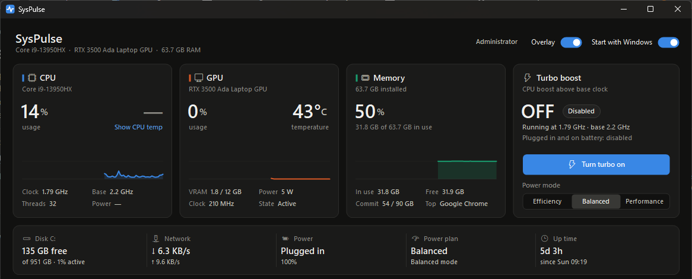

# SysPulse

**An FPS-counter style overlay for your CPU and GPU, and a one-click turbo boost switch, for Windows.**
One portable exe: no install, no account, about 0.1% CPU.

[](https://github.com/AlexIvlev91/SysPulse/releases/latest)
[](https://github.com/AlexIvlev91/SysPulse/actions/workflows/build.yml)
[](LICENSE)


SysPulse sits in the tray and shows CPU/GPU temperature and load, switches CPU turbo
boost on and off, and points out apps worth closing to free memory or CPU. The overlay
stays in a corner of the screen, always on top and click-through, like an in-game FPS
counter.



**[Download SysPulse.exe](https://github.com/AlexIvlev91/SysPulse/releases/latest/download/SysPulse.exe)**.
If SysPulse is useful to you, a ⭐ on GitHub helps other people find it.

## Download

Get `SysPulse.exe` from the [latest release](https://github.com/AlexIvlev91/SysPulse/releases/latest)
and double-click it. There's nothing to install and .NET doesn't need to be on the PC.
It runs on 64-bit Windows 10 and 11. To keep it, put it somewhere permanent (for example
`%LOCALAPPDATA%\Programs\SysPulse`) and turn on **Start with Windows** in the app.

The exe isn't code-signed yet, so the first time Windows may say *"Windows protected
your PC"*. Click **More info → Run anyway**. The release build is made by GitHub
Actions from the tagged source ([release.yml](.github/workflows/release.yml)).

## Features

- **Overlay**: a white CPU / GPU / RAM / turbo readout in the top-right corner, always
  on top and click-through. Toggle it with **Ctrl+Shift+O**, the switch in the
  window, or the tray menu. Hold **Ctrl** over it to show a close button, or drag it
  somewhere else.
- **Overlay settings** (gear next to the Overlay switch, or the tray menu): stacked or
  one-line layout, small / medium / large, text color (presets or any custom color),
  opacity 20–100%, optional dark backplate, and position. Pick any corner or edge, then fine-tune with the arrow buttons (hold to
  keep moving) or the arrow keys (1 px, Shift for 10 px). Changes apply live.
- **CPU**: load (Task Manager's "% Processor Utility"), live clock speed against
  the base clock, and package temperature and power (see below).
- **GPU**: load, temperature, VRAM, power and clock for NVIDIA GPUs (NVML, no admin
  needed). Load only for other GPUs. On hybrid laptops SysPulse checks the GPU's
  power state first and stops polling while it's idle, so it never keeps the dGPU awake.
- **Turbo boost**: one button that does the same as
  `powercfg /setacvalueindex SCHEME_CURRENT SUB_PROCESSOR PERFBOOSTMODE 0` (plus the DC
  value and `/setactive`). Turning it back on restores the previous boost mode
  (Aggressive by default). Also available from the tray menu and the command line:
  `SysPulse.exe --turbo off` / `--turbo on`.
- **Power mode**: the Windows 11 Efficiency / Balanced / Performance switch.
- **Free up memory and CPU**: apps grouped by program (all `chrome.exe` processes
  together) and sorted by memory or CPU. Open apps are closed normally, so they can
  still ask to save. Background apps are ended. Windows components, services and
  shell processes are never listed.
- Disk free space and activity, network speed, battery, power plan, uptime.
- **Start with Windows** switch. SysPulse starts in the tray with the overlay.
  Closing the window keeps it running in the tray; exit from the tray menu.

## CPU temperature

Windows has no API that lets regular apps read a modern CPU's temperature. SysPulse
reads it with [LibreHardwareMonitorLib](https://github.com/LibreHardwareMonitor/LibreHardwareMonitor)
through the signed **PawnIO** driver, which needs:

1. PawnIO installed (one time): `winget install namazso.PawnIO`, or from https://pawnio.eu
2. SysPulse running as administrator ("Run as administrator" in the header).

Turn on **Start with Windows** *while running as administrator* to register a
logon task that runs elevated, so CPU temperature works after every sign-in without
a UAC prompt. Otherwise startup uses the normal `HKCU\...\Run` entry. Click
"Show CPU temp" in the CPU card for these steps.

## Build

Requires the .NET 8 SDK (or newer) on Windows.

```bash
dotnet build src/SysPulse -c Release
```

To make the app, publish one portable exe with .NET bundled inside:

```bash
dotnet publish src/SysPulse -p:PublishProfile=SingleExe
```

This produces `publish\SysPulse.exe` (about 65 MB) with .NET inside. The first launch
of a new copy is slower while Windows scans it. If Start with Windows was turned on
from another copy, the startup entry moves to whichever copy you launch.

To publish a release, push a version tag. GitHub Actions builds the exe and attaches
it, with the licenses, to a new GitHub release:

```bash
git tag v1.0.1
```

```bash
git push origin v1.0.1
```

For UI checks without touching the desktop, `SysPulse.exe --snapshot <folder>` samples
the real sensors for a few seconds off-screen and saves `main.png`, `overlay.png`,
`overlay-ctrl.png` and the readings to that folder.

## Files

Settings live in `%LOCALAPPDATA%\SysPulse\settings.json`.

## Contributing

Issues and pull requests are welcome. Please keep changes in the style of the
surrounding code, and check the UI with `--snapshot` before sending a pull request.

## License

SysPulse is released under the [MIT License](LICENSE). It bundles open-source
libraries under their own licenses; see [THIRD-PARTY-NOTICES.md](THIRD-PARTY-NOTICES.md).
